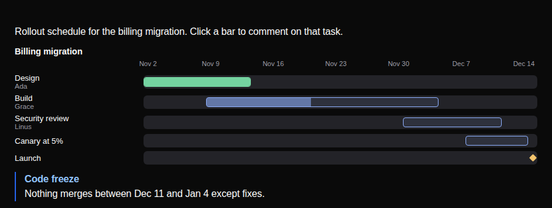

# austere-pack-gantt

A Gantt chart for [austere-axi](https://github.com/MandalorianBatman/austere-axi) review pages. An agent writes `Gantt` and `GanttTask` in a page; the reviewer sees bars on a shared date axis and can comment on any one of them.



This is also the worked example for [Writing a pack](https://github.com/MandalorianBatman/austere-axi#write-a-pack). It uses only the public `austere-axi/pack` API and the catalog format, and has no import from inside austere-axi. Copy it to start your own.

## Use it

```sh
npm install -g austere-axi                        # once
austere-axi components add austere-pack-gantt --trust
austere-axi check --fix plan.html                 # declares the pack in the page head
```

`--trust` is required for any pack outside `@austere-axi/`: its code runs inside your review pages, so read it first. It is one 8 KB bundle built from `src/`.

```
plan = Gantt([design, build, review, launch], "Q4 rollout")
design = GanttTask("Design", "2026-11-02", "2026-11-13", 100, "Ada")
build = GanttTask("Build", "2026-11-09", "2026-12-04", 45, "Grace")
review = GanttTask("Security review", "2026-12-01", "2026-12-11", 0, "Linus")
launch = GanttTask("Launch", "2026-12-14")
```

A full page is in [`examples/rollout.html`](examples/rollout.html). It does not declare the pack on purpose: `check` reports `missing-pack` and `check --fix` adds the tag.

| Component | Props (positional) |
|---|---|
| `Gantt` | `tasks: GanttTask[]`, `title?: string` |
| `GanttTask` | `name`, `start`, `end?`, `progress?`, `owner?` |

- Dates are `YYYY-MM-DD`; `end` is inclusive. Leave `end` out (or `""`) for a one-day milestone, drawn as a diamond.
- `progress` is 0 to 100. A task at 100 turns green.
- A task with a bad date, or an end before its start, keeps its row and shows why instead of a bar. It never hides the chart.
- Each row is its own annotation target, named by the task.
- The axis picks the finest unit that fits 8 labels: days, every other day, Mondays, every other Monday, then months.

## Develop

```sh
npm install
npm run build          # src/ -> dist/pack.js + dist/catalog.json
npm test               # date and layout logic, no browser
npm run check:example  # npm pack, install the .tgz with --trust, check the example
npx austere-axi components add .    # use the folder build on this machine
```

| Path | What it is |
|---|---|
| `src/Gantt.jsx` | `GanttTask` (value-only, renders nothing) and `Gantt` (draws the chart) |
| `src/dates.js` | Date parsing and bar layout. Pure functions, unit tested |
| `src/style.css` | Styles on the page's `--austere-*` variables; every class is prefixed `pack-gantt` |
| `src/index.js` | Default export `{ components, css }`: the pack's entry |
| `dist/` | Build output. Committed, and CI fails if it is stale |
| `test/`, `scripts/` | Tests and the install check. Not published |

Rules the pack follows, from austere-axi's pack contract:

- Props are positional and append-only once published. Add new props at the end and make them optional.
- React, zod and `austere-axi/pack` are never bundled; the build maps them onto the page's copies.
- Nothing runs at module level that needs `window` or `document`: `components build` loads the pack in Node to read its signatures.
- Bump `version` for any change to `dist/`.

## Publish

```sh
npm run build && npm test
npm publish          # prepublishOnly runs both again
```

Or publish a GitHub Release: [`publish.yml`](.github/workflows/publish.yml) tests and publishes with npm trusted publishing (configure the trusted publisher once on npmjs.com).

## License

MIT
